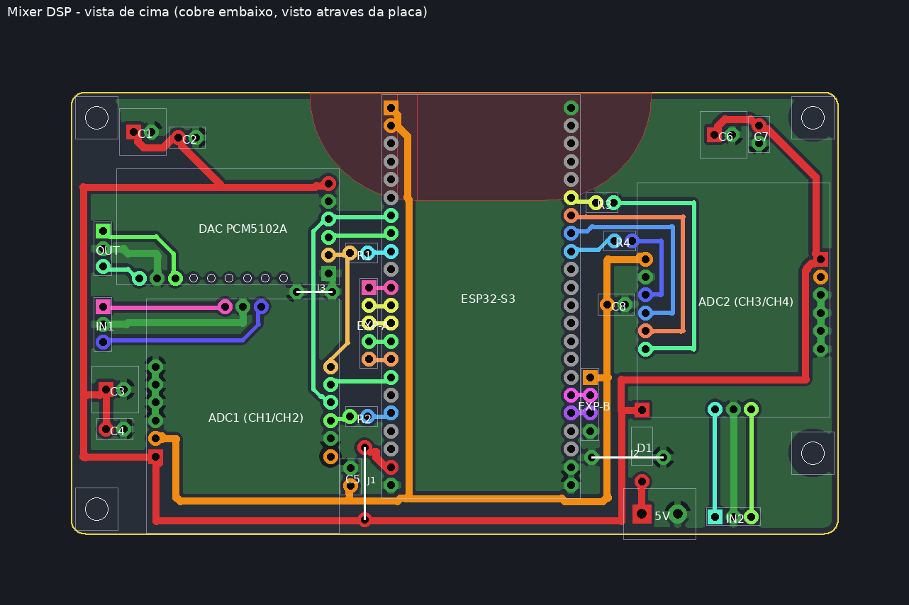

# PCB de uma face do Mixer DSP (ESP32-S3 + 2× PCM1808 + PCM5102A)



## Resumo

| | |
|---|---|
| Tamanho | **108,2 × 62,5 mm**, cantos arredondados, 4 furos M3 |
| Cobre | **uma face (embaixo)**; componentes em cima, todos de furo passante |
| Trilhas | sinal 0,6 mm · alimentação 1,0 mm · isolamento ≥ 0,5 mm · cobre a ≥ 1,0 mm da borda |
| Jumpers de fio | **3**: J1 (+5V até o 5Vin do ESP), J2 (ponte de GND), J3 (SCK do DAC ao GND) |
| Plano de terra | GND em todo o cobre livre, com alívio térmico nos pads de GND |
| Antena | sai da borda de cima; zona sem cobre e sem componentes de 15 mm em volta (tracejado na serigrafia) |
| USB | na borda de baixo (≈5 mm para dentro; o plugue passa por cima da placa) |
| GPIO | 7 dos 9 pinos I2S mudaram: ver [`firmware-pinos.md`](firmware-pinos.md) |

## Arquivos

| Arquivo | O que é |
|---|---|
| `mixer-dsp-pcb.unipcb` | **projeto para o UniPCB** (abrir em *Abrir*) |
| `fabricacao/` | Gerber + Excellon exportados **pelo próprio UniPCB** (`buildFab()`), SVGs 1:1 do cobre (normal e espelhado), serigrafia, furos e contorno |
| `gabarito-1a1.pdf` | gabarito para imprimir em 100 %: furos + contorno + módulos (pág. 1) e cobre espelhado (pág. 2), com régua de 50 mm |
| `netlist.md` | todas as ligações, pino a pino (gerado do projeto) |
| `teste-continuidade.md` | roteiro de teste com multímetro, na ordem |
| `montagem.md` | ordem de soldagem, pontes dos módulos, alimentação e laser |
| `firmware-pinos.md` | nova tabela de GPIO e o que mudar no firmware |
| `imagens/` | vista de cima, cobre espelhado, mapa dos jumpers, tela do UniPCB e a tentativa da proposta A |
| `relatorio.json` | números do gerador: ERC, DRC, jumpers, comprimento dos clocks, conferência com a especificação |
| `gerador/` | scripts que geram tudo isto (Python + Node) |
| `unipcb.html` | cópia do UniPCB, usada só para validar e exportar |

## Arranjo escolhido (proposta B) e comparação

As duas propostas usam a mesma regra da antena: 15 mm sem cobre e sem módulos em volta dela.

| | **B: ESP no centro (escolhida)** | A: ESP na borda, tudo de um lado |
|---|---|---|
| Área | 108,2 × 62,5 mm (6762 mm²) | 104,8 × 62,5 mm (6550 mm²) |
| Jumpers | **3** | **≥ 8 só nos sinais**, e mesmo assim 5V/GND ficaram abertos no roteamento automático (`imagens/proposta-A-tentativa.png`) |
| Clocks | MCLK1 6 mm, MCLK2 21 mm, BCLK1 23 mm, BCLK2 42 mm | mais longos (o ADC2 fica "atrás" do ADC1/DAC) |
| Por quê | O I2S0 (ADC1 + DAC) sai pela fileira esquerda do ESP e o I2S1 (ADC2) pela direita. O 3V3 passa por baixo do ESP, e o 5V por uma faixa sob a ponta da USB. | Os 4 sinais do ADC2, o 5V e o 3V3 precisam cruzar os sinais do ADC1/DAC |

A B é só 3 % maior e evita uns 7 jumpers. Uma tentativa de deixá-la menor esbarra na zona da antena: módulos encostados no ESP precisam começar uns 11 mm abaixo da borda de cima.

Detalhes que valem para o áudio:
- O GND de cada borne de entrada e de saída vai **direto ao pino de GND analógico do próprio módulo** (GNDc do PCM1808, AGND do PCM5102A). O sinal e o seu terra andam juntos.
- MCLK1 e MCLK2 são curtos e não correm paralelos.
- As entradas ficam na borda, longe dos clocks.
- Os resistores de 33 Ω em série no MCLK e no BCLK ficam colados no ESP.

## Como foi verificado

Tudo abaixo foi rodado de fato (números em `relatorio.json`, `fabricacao/validacao-unipcb.json` e `fabricacao/verificacao-gerber.json`):

1. **ERC do gerador**: 30 redes, **0 abertas, 0 curtos**. Os jumpers e as ligações internas dos módulos contam como ligação.
2. **Conferência com a tabela da especificação** (seção 2, pinos remapeados): **todos OK**:
   - cada sinal I2S sai do GPIO certo e chega ao pino certo do módulo (através dos resistores de 33 Ω);
   - 5V, 3V3 e GND chegam aos pinos certos;
   - MD0, MD1 e FMT dos dois ADC estão no GND;
   - SCK do DAC está no GND.
3. **DRC**: **0 erros**.
   - Folga mínima de 0,519 mm (limite 0,5).
   - Largura mínima 0,6 mm.
   - Cobre a 1,000 mm da borda.
   - Anel de 0,5 mm (pad Ø2,0 / furo Ø1,0).
   - Furo sem cobre a 0,52 mm do cobre.
   - Furo a furo: 1,44 mm.
   - Nenhum componente dentro da zona da antena.
4. **UniPCB de verdade**: o `.unipcb` foi aberto no `unipcb.html` pelo Chrome headless (Playwright). Carregou **sem nenhum erro**: 258 itens, ou seja, 30 componentes, 95 trilhas, 5 áreas de cobre e 95 textos. O Gerber e o Excellon foram exportados pela função `buildFab()` do programa. A foto da tela está em `imagens/unipcb-tela.png`.
5. **Conferência independente do Gerber exportado** (gerbonara):
   - o cobre foi reconstruído a partir do `B_Cu.gbl`;
   - **30 de 30 redes ligadas, nenhum curto**;
   - folga mínima de 0,519 mm, cobre-borda de 1,0 mm;
   - todos os 145 pads com o furo certo no `.drl` (133 de Ø1,0, 6 de Ø1,1, 2 de Ø1,3 e 4 de Ø3,2).

## O que NÃO foi verificado (e onde ainda há medida PROVISÓRIA)

- **Medidas dos módulos de áudio: PROVISÓRIO.** Vieram de fotos da internet, com a escala tirada do passo de 2,54 mm:
  - PCM1808: distância entre as fileiras 24,69 mm; coluna das entradas a 21,2 mm.
  - PCM5102A: fileira longa começando a 6,35 mm do cabeçalho.
  - **Confira com o gabarito 1:1 antes de cortar.** A placa do ESP (YD-ESP32-S3) segue o desenho métrico do fabricante.
- **3,3 V do PCM1808**: a PCB liga só um dos dois pinos "3.3V" de cada módulo. Isso supõe que os dois estão ligados dentro do módulo; teste com o multímetro (item 0 de `teste-continuidade.md`).
- **Zona da antena**: uma exceção consciente. A trilha de 3V3 sai do pino 3V3 do ESP e passa **por baixo da própria placa do ESP** cerca de 14 mm dentro da zona, porque o pino 3V3 fica ali e não há outro caminho. É a única coisa de cobre na zona.
- O laser não foi testado. Também não foi testado: firmware compilado com os pinos novos, medição de áudio (ruído, THD) e alcance do Wi-Fi.
- O jack de 3,5 mm do módulo DAC fica virado para cima, de frente para o C1, e não dá para usar. A saída é pelo borne **OUT** (X3).

## Pendências (perguntas da especificação ainda sem resposta)

1. **Laser**: tipo, trilha e folga mínimas confiáveis, formato do arquivo (Gerber, SVG ou DXF), tamanho máximo da placa e material, e se ele corta o contorno. Hoje: 0,6/0,5 mm.
2. **Face do cobre**: supus **embaixo**. Se for em cima, basta trocar `copper='B.Cu'` por `F.Cu` em `gerador/exportar.py`.
3. **Soquete ou solda direta** nos módulos: o projeto serve para os dois.
4. Medidas reais dos módulos (paquímetro) e fotos, para tirar o PROVISÓRIO.
5. Firmware: para eu aplicar a troca de GPIO e rodar os testes de host.

## Como regenerar

```
cd pcb/gerador
python3 gerar_pcb.py
node validar_unipcb.mjs
python3 verificar_gerber.py
python3 gabarito.py
python3 documentar.py
```

Requisitos:
- Python 3 com `shapely`, `gerbonara`, `scipy`, `numpy`, `pillow` e `reportlab`;
- Node com `playwright`, só para a validação no UniPCB.

As medidas e regras ficam no começo de `gerador/projeto.py` (`PARAM`) e de `gerador/footprints.py`.
